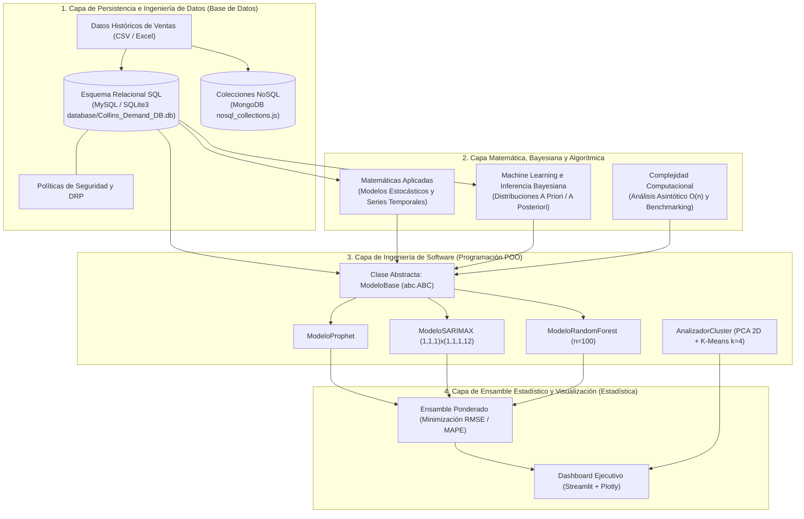

# 📘 Documentación Técnica General — Proyecto Integrador 3 (Pronóstico de la Demanda Grupo Collins)

**Autor:** Roberto Alejandro Chagra Martínez  
**Versión:** 3.0.0  
**Stack:** Python 3.12 · Prophet 1.2 · Statsmodels (SARIMAX) · Scikit-Learn 1.7 · Streamlit · Plotly · SQLite3 · MySQL · MongoDB  

---

## 1. Arquitectura Global del Ecosistema

El proyecto resuelve el pronóstico de demanda farmacéutica para **Grupo Collins** articulando cinco disciplinas complementarias de Ingeniería en Ciencia de Datos sobre un flujo unificado de datos históricos de ventas:

---

## 2. Especificación Técnica por Submódulo

### 2.1 Machine Learning, Inferencia Bayesiana y Matemáticas Aplicadas
- **Directorio:** [`Proyecto Integrador ML & Matematicas/`](file:///g:/Mi%20unidad/Drive.alumno.udg.mx/Proyectos/Proyecto%20integrador%203/Proyecto%20Integrador%20ML%20&%20Matematicas/DOCUMENTACION_TECNICA.md)
- **Fundamento Matemático:**
  - Descomposición aditiva y multiplicativa de series temporales de pedidos farmacéuticos ($Y_t = T_t + S_t + R_t$).
  - Actualización bayesiana de parámetros de demanda mediante verosimilitud conjugada para cuantificar la incertidumbre en productos de alta volatilidad estacional (analgésicos, antigripales y antibióticos).

### 2.2 Complejidad Computacional
- **Directorio:** [`Proyecto Integrador Complejidad Computacional/`](file:///g:/Mi%20unidad/Drive.alumno.udg.mx/Proyectos/Proyecto%20integrador%203/Proyecto%20Integrador%20Complejidad%20Computacional/)
- **Evaluación Algorítmica:**
  - Medición empírica de tiempos de ejecución y consumo de memoria al escalar el horizonte temporal $T$ y la cardinalidad de combinaciones Producto-Cliente ($P \times C = 10 \times 5 = 50$ series).
  - Comparación entre métodos autorregresivos exactos (inversión de matrices de covarianza en SARIMAX) frente a árboles ensamblados paralelizados (`RandomForestRegressor`) y ajuste por L-BFGS/Stan en `Prophet`.

### 2.3 Programación Orientada a Objetos (POO)
- **Directorio:** [`Proyecto Integrador Programacion/`](file:///g:/Mi%20unidad/Drive.alumno.udg.mx/Proyectos/Proyecto%20integrador%203/Proyecto%20Integrador%20Programacion/DOCUMENTACION_TECNICA.md)
- **Archivo Principal:** [`src/Main.py`](file:///g:/Mi%20unidad/Drive.alumno.udg.mx/Proyectos/Proyecto%20integrador%203/Proyecto%20Integrador%20Programacion/src/Main.py)
- **Diseño de Clases:**
  - `Configuracion`: Centraliza hiperparámetros (`TOP_PRODUCTOS = 10`, `TOP_CLIENTES = 5`, `SARIMA_ORDER = (1, 1, 1)`, `SEASONAL_ORDER = (1, 1, 1, 12)`, `RF_ESTIMADORES = 100`).
  - `GestorDatos`: Limpieza, agregación mensual y filtrado de la matriz Top 10×5.
  - `ModeloBase(ABC)`: Define la interfaz polimórfica `entrenar(df)` y `predecir(periodos)` implementada por `ModeloProphet`, `ModeloSARIMAX` y `ModeloRandomForest`.
  - `AnalizadorCluster`: Estandariza perfiles de compra, aplica **PCA** (2 componentes principales) y segmenta clientes mediante **K-Means** ($k=4$).

### 2.4 Base de Datos (SQL / NoSQL y Seguridad)
- **Directorio:** [`Proyecto Integrador Base de Datos/`](file:///g:/Mi%20unidad/Drive.alumno.udg.mx/Proyectos/Proyecto%20integrador%203/Proyecto%20Integrador%20Base%20de%20Datos/)
- **Componentes:**
  - **Modelo Relacional (SQL)**: Tablas normalizadas para catálogo de productos farmacéuticos, clientes mayoristas, histórico transaccional de ventas y lotes de pronóstico.
  - **Modelo Documental ([`nosql_collections.js`](file:///g:/Mi%20unidad/Drive.alumno.udg.mx/Proyectos/Proyecto%20integrador%203/Proyecto%20Integrador%20Base%20de%20Datos/nosql_collections.js))**: Colecciones en MongoDB diseñadas para almacenar series de tiempo anidadas, metadatos de hiperparámetros de corridas de ML y logs de auditoría.
  - **Seguridad y Continuidad ([`DRP.pdf`](file:///g:/Mi%20unidad/Drive.alumno.udg.mx/Proyectos/Proyecto%20integrador%203/Proyecto%20Integrador%20Base%20de%20Datos/DRP.pdf))**: Políticas de control de acceso basado en roles (RBAC), respaldos automatizados y Plan de Recuperación ante Desastres (RPO/RTO).

### 2.5 Estadística y Dashboard de Ensamble Predictivo
- **Directorio:** [`Proyecto Integrador Estadistica/`](file:///g:/Mi%20unidad/Drive.alumno.udg.mx/Proyectos/Proyecto%20integrador%203/Proyecto%20Integrador%20Estadistica/DOCUMENTACION_TECNICA.md)
- **Archivos Clave:** [`src/run.py`](file:///g:/Mi%20unidad/Drive.alumno.udg.mx/Proyectos/Proyecto%20integrador%203/Proyecto%20Integrador%20Estadistica/src/run.py), [`src/db_manager.py`](file:///g:/Mi%20unidad/Drive.alumno.udg.mx/Proyectos/Proyecto%20integrador%203/Proyecto%20Integrador%20Estadistica/src/db_manager.py), [`SOLUTION_CHALLENGE_ENSAMBLE.ipynb`](file:///g:/Mi%20unidad/Drive.alumno.udg.mx/Proyectos/Proyecto%20integrador%203/Proyecto%20Integrador%20Estadistica/SOLUTION_CHALLENGE_ENSAMBLE.ipynb)
- **Arquitectura del Ensamble y Visualización:**
  - Combina las predicciones individuales ($\hat{y}_{\text{Prophet}}, \hat{y}_{\text{SARIMAX}}, \hat{y}_{\text{RF}}$) ponderando inversamente al error de validación histórica (RMSE y MAPE).
  - Persiste los resultados consolidados en SQLite ([`database/Collins_Demand_DB.db`](file:///g:/Mi%20unidad/Drive.alumno.udg.mx/Proyectos/Proyecto%20integrador%203/Proyecto%20Integrador%20Estadistica/database/Collins_Demand_DB.db)) mediante `src/db_manager.py`.
  - Despliega un tablero interactivo en **Streamlit** con gráficos dinámicos de **Plotly** para inspeccionar intervalos de confianza, estacionalidad y residuales por SKU y cliente.
