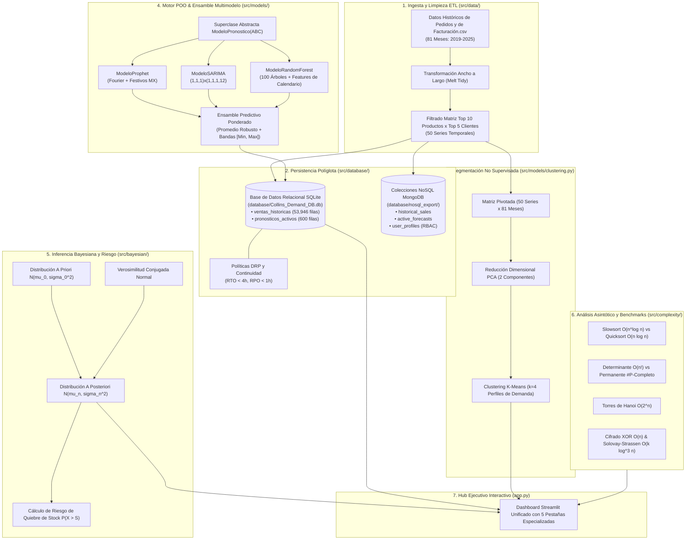

# 📘 Documentación Técnica del Sistema Unificado — Proyecto Integrador 3

**Cliente de Estudio:** Grupo Farmacéutico Collins S.A. de C.V.  
**Autor:** Roberto Alejandro Chagra Martínez  
**Institución:** Universidad de Guadalajara (UDG) — Ingeniería en Ciencia de Datos  
**Versión:** 3.0.0 (Edición Integral)  
**Tecnologías:** Python 3, Prophet, Statsmodels (SARIMAX), Scikit-Learn (Random Forest, K-Means, PCA), Inferencia Bayesiana, Streamlit, Plotly, SQLite3, MongoDB (NoSQL)  

---

## 1. Visión General de la Unificación

Este proyecto consolida de manera integral las **cinco materias y proyectos disciplinares** del tercer semestre del Proyecto Integrador en una arquitectura cohesiva, modular y de nivel productivo. Los archivos base y carpetas originales de cada submódulo han sido rigurosamente preservados, mientras que una capa unificada (`src/`, `app.py`, `main.py`, `tests/`) orquesta la interacción entre todos los componentes:



---

## 2. Correspondencia con los 5 Proyectos Base en `subproyectos/`

| # | Módulo Original | Carpeta Base Preservada | Implementación Unificada en `src/` |
| :--- | :--- | :--- | :--- |
| **1** | **Estadística** | [`subproyectos/Proyecto Integrador Estadistica/`](file:///g:/Mi%20unidad/Drive.alumno.udg.mx/Proyectos/Proyecto%20integrador%203/subproyectos/Proyecto%20Integrador%20Estadistica/) | `src/models/ensemble.py`, `app.py` (Tab 1: Demand Planner), `database/Collins_Demand_DB.db` |
| **2** | **Programación** | [`subproyectos/Proyecto Integrador Programacion/`](file:///g:/Mi%20unidad/Drive.alumno.udg.mx/Proyectos/Proyecto%20integrador%203/subproyectos/Proyecto%20Integrador%20Programacion/) | `src/models/base.py`, `src/models/prophet_model.py`, `src/models/sarima_model.py`, `src/models/random_forest_model.py`, `src/models/clustering.py` |
| **3** | **ML & Matemáticas** | [`subproyectos/Proyecto Integrador ML & Matematicas/`](file:///g:/Mi%20unidad/Drive.alumno.udg.mx/Proyectos/Proyecto%20integrador%203/subproyectos/Proyecto%20Integrador%20ML%20&%20Matematicas/) | `src/bayesian/inference.py`, `app.py` (Tab 3: Inferencia Bayesiana & Descomposición $Y_t = T_t + S_t + R_t$) |
| **4** | **Complejidad Computacional** | [`subproyectos/Proyecto Integrador Complejidad Computacional/`](file:///g:/Mi%20unidad/Drive.alumno.udg.mx/Proyectos/Proyecto%20integrador%203/subproyectos/Proyecto%20Integrador%20Complejidad%20Computacional/) | `src/complexity/benchmarks.py`, `app.py` (Tab 4: Benchmarking en vivo de algoritmos $O(n)$, $O(n \log n)$, $O(2^n)$, $O(n!)$) |
| **5** | **Base de Datos** | [`subproyectos/Proyecto Integrador Base de Datos/`](file:///g:/Mi%20unidad/Drive.alumno.udg.mx/Proyectos/Proyecto%20integrador%203/subproyectos/Proyecto%20Integrador%20Base%20de%20Datos/) | `src/database/db_manager.py`, `src/database/nosql_manager.py`, `app.py` (Tab 5: Consola SQL, MongoDB JSON, Matriz RBAC y DRP) |

---

## 3. Formulación Matemática y Estadística

### 3.1 Modelo de Ensamble de Pronóstico
Para cada serie temporal $i \in \{1, \dots, 50\}$ (correspondiente al par Producto-Cliente) y horizonte mensual futuro $h \in \{1, \dots, 12\}$:
$$\hat{y}_{i, t+h}^{\text{Ensemble}} = \frac{1}{M} \sum_{m=1}^{M} \hat{y}_{i, t+h}^{(m)}$$
donde $M = 3$ corresponde a las predicciones generadas por **Prophet**, **SARIMAX** y **Random Forest**.

Las bandas de incertidumbre operacional se delimitan mediante:
$$\text{Límite Inferior}_{i, t+h} = \min_{m} \left( \hat{y}_{i, t+h}^{(m), \text{lower}} \right), \quad \text{Límite Superior}_{i, t+h} = \max_{m} \left( \hat{y}_{i, t+h}^{(m), \text{upper}} \right)$$

### 3.2 Inferencia Bayesiana Conjugada (Normal-Normal)
La demanda farmacéutica media $\mu$ de cada producto clave se actualiza con una distribución previa $\mu \sim \mathcal{N}(\mu_0, \sigma_0^2)$ y verosimilitud muestral $X \sim \mathcal{N}(\mu, \sigma^2)$:
$$\tau_0 = \frac{1}{\sigma_0^2}, \quad \tau = \frac{n}{\sigma^2}, \quad \tau_n = \tau_0 + \tau$$
$$\mu_n = \frac{\tau_0 \mu_0 + \tau \bar{x}}{\tau_n}, \quad \sigma_n = \frac{1}{\sqrt{\tau_n}}$$

El riesgo de quiebre de stock para un nivel de inventario de seguridad $S$ es:
$$P(\text{Desabasto}) = 1 - \Phi\left(\frac{S - \mu_n}{\sqrt{\sigma^2 + \sigma_n^2}}\right)$$

---

## 4. Análisis de Complejidad Asintótica

| Problema | Algoritmo | Complejidad Temporal | Complejidad Espacial | Clase / Característica |
| :--- | :--- | :--- | :--- | :--- |
| **Problema 1** | **Slowsort** | $\mathcal{O}(n^{\frac{\log n}{2 + \epsilon}})$ | $\mathcal{O}(n)$ | Algoritmo humorístico/pesimista ("Multiply and Surrender") |
| | **Quicksort** | $\mathcal{O}(n \log n)$ prom. / $\mathcal{O}(n^2)$ peor | $\mathcal{O}(\log n)$ | Divide y vencerás óptimo |
| **Problema 2** | **Determinante** (Laplace) | $\mathcal{O}(n!)$ | $\mathcal{O}(n)$ recursivo | Expansión de cofactores |
| | **Permanente** | $\#\text{P-Completo}$ ($\mathcal{O}(n!)$ naive / $\mathcal{O}(n 2^n)$ Ryser) | $\mathcal{O}(n)$ | Sin alternancia de signos |
| **Problema 3** | **Solovay-Strassen** | $\mathcal{O}(k \log^3 n)$ | $\mathcal{O}(1)$ | Test probabilístico de primalidad (Símbolo de Jacobi) |
| **Problema 4** | **Torres de Hanoi** | $\mathcal{O}(2^n)$ | $\mathcal{O}(n)$ llamada | $2^n - 1$ movimientos obligatorios |
| **Problema 5** | **Algoritmo de Fleury** | $\mathcal{O}(|E|^2)$ | $\mathcal{O}(|V| + |E|)$ | Recorrido de camino/circuito Euleriano |
| **Problema 6** | **Cifrado XOR** | $\mathcal{O}(n)$ | $\mathcal{O}(n)$ | Cifrado simétrico de flujo (stream cipher) |

---

## 5. Persistencia y Políticas de Seguridad DRP

### 5.1 Esquema Relacional SQL (SQLite3 / MySQL)
- **Tabla `ventas_historicas`:**
  - Clave Primaria compuesta: `(Producto_Descripcion, Cliente_Descripcion, Fecha)`.
  - Registros actuales: `53,946` filas (histórico de pedidos mensuales 2019-2025).
- **Tabla `pronosticos_activos`:**
  - Clave Primaria compuesta: `(Producto_Descripcion, Cliente_Descripcion, Fecha_Pronostico)`.
  - Atributos: `Cluster`, `Pronostico_Ensemble_PedidoPiezas`, `Pronostico_Min`, `Pronostico_Max`.
  - Registros actuales: `600` filas ($10 \text{ productos} \times 5 \text{ clientes} \times 12 \text{ meses}$).

### 5.2 Esquema Documental NoSQL (MongoDB)
- Colección `historical_sales`: Documentos anidados con metadatos de canal farmacéutico.
- Colección `active_forecasts`: Pronósticos consolidados con objetos de intervalo de confianza.
- Colección `user_profiles`: Matriz de seguridad RBAC (`dbAdmin`, `demandPlanner`, `auditor`).

### 5.3 Plan de Recuperación ante Desastres (DRP)
- **RTO (Recovery Time Objective):** $< 4$ horas para restauración total de servicios analíticos.
- **RPO (Recovery Point Objective):** $< 1$ hora de datos mediante replicación y copias periódicas.

---

## 6. Guía de Uso y Comandos

### Diagnóstico del Sistema
```bash
python main.py --status
```

### Ejecutar Suite Completa de Pruebas Unitarias
```bash
python run_tests.py
```

### Ejecutar Benchmarks de Complejidad
```bash
python main.py --benchmarks
```

### Ejecutar Pipeline Predictivo de Punta a Punta
```bash
python main.py --pipeline
```

### Iniciar el Dashboard Ejecutivo (Streamlit)
```bash
python main.py --dashboard
# O directamente:
python run_dashboard.py
# O en Windows:
iniciar_sistema.bat
```
