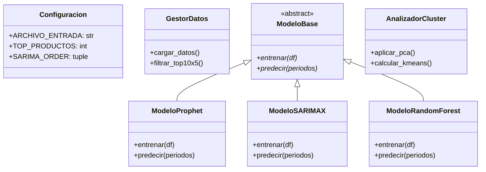

# Documentación Técnica: Motor Empresarial de Pronóstico de Demanda POO
**Autor:** Roberto Alejandro Chagra Martínez  
**Tecnologías:** Prophet, SARIMAX (Statsmodels), RandomForest, KMeans, PCA, Streamlit, SQLite3  
**Tipo:** Sistema de Forecasting Empresarial Orientado a Objetos (Top 10x5)  

---

## 1. Descripción del Proyecto
Sistema de software empresarial que pronostica la demanda futura de los 10 productos más vendidos a través de los 5 principales clientes de una compañía. Emplea un enfoque riguroso de **Programación Orientada a Objetos** con clases abstractas (`abc.ABC`), ensamble multimodelo (Prophet + SARIMAX + Random Forest) y clusterización por patrones de consumo con PCA y K-Means.

---

## 2. Componentes Clave ([`src/Main.py`](file:///g:/Mi%20unidad/Drive.alumno.udg.mx/Proyectos/Proyecto%20integrador%203/Proyecto%20Integrador%20Programacion/src/Main.py))
* `Configuracion`: Clase centralizada que gestiona hiperparámetros (`SARIMA_ORDER = (1, 1, 1)`, estacionalidad `(1, 1, 1, 12)`, `RF_ESTIMADORES = 100`, etc.).
* `GestorDatos`: Encapsula la ingesta, limpieza de formatos de fecha y agregación mensual de pedidos.
* `ModeloBase`: Interfaz con métodos polimórficos de entrenamiento y proyección temporal.
* `AnalizadorCluster`: Segmenta a los clientes según volatilidad y volumen de compra utilizando reducción de dimensionalidad PCA (2 componentes) y K-Means ($k=4$).
